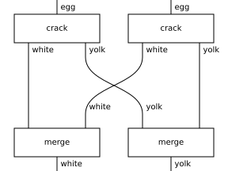
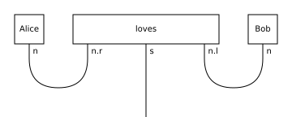
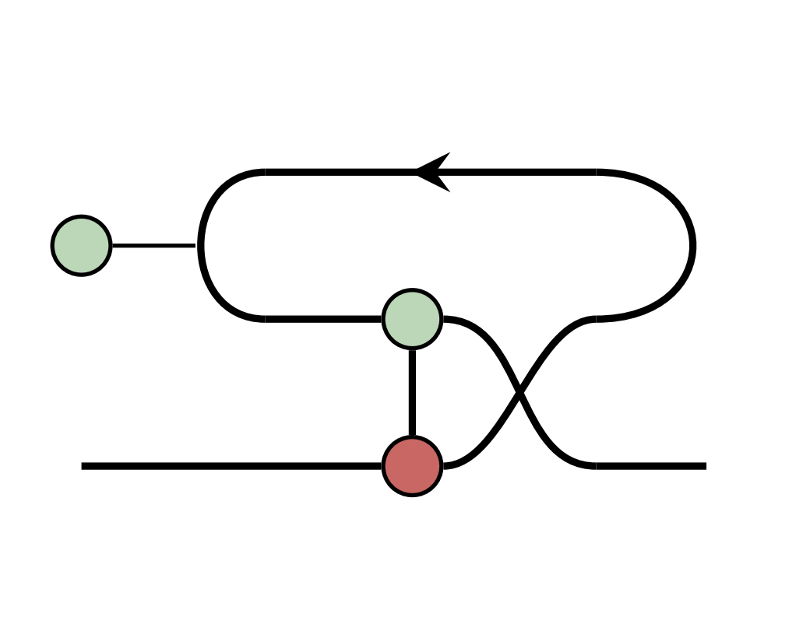

# Code

-  **[DisCoPy](https://discopy.org/)** The toolkit for computing with string diagrams. Created by [Alexis Toumi](https://alexis.toumi.xyz/) and co-created by [Giovanni de Felice](https://scholar.google.com/citations?user=-_bkN1gAAAAJ&hl=en). Source on [GitHub](https://github.com/discopy/discopy).
-  **[lambek](https://github.com/rel-int/discopy-next/tree/main/discopy/lambek)** A library for categorial grammars and formal linguistics, successor of [lambeq](https://github.com/Quantinuum/lambeq). It now lives in discopy-next, as `discopy.lambek`.
-  **[optyx](https://github.com/rel-int/discopy-next/tree/main/discopy/optyx)** ZX-based software for networked quantum computing. It now lives in discopy-next, as `discopy.optyx`.
{: .cols-3 .cards .code}

The first two diagrams are drawn by DisCoPy. The third is from the [optyx paper](https://arxiv.org/abs/2512.09648).
{: .muted}
